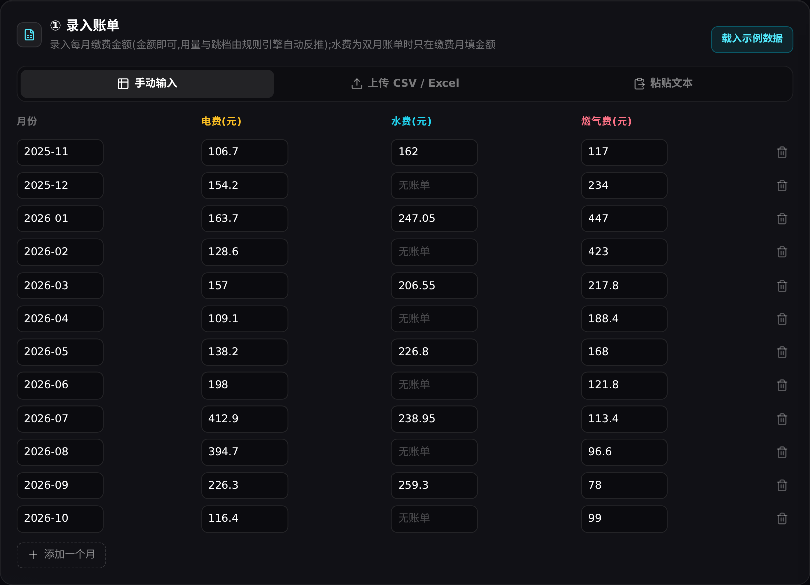
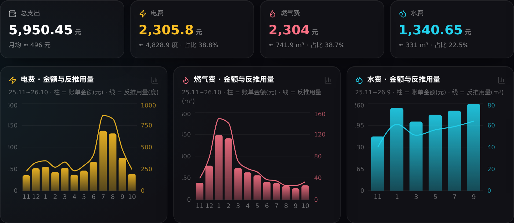
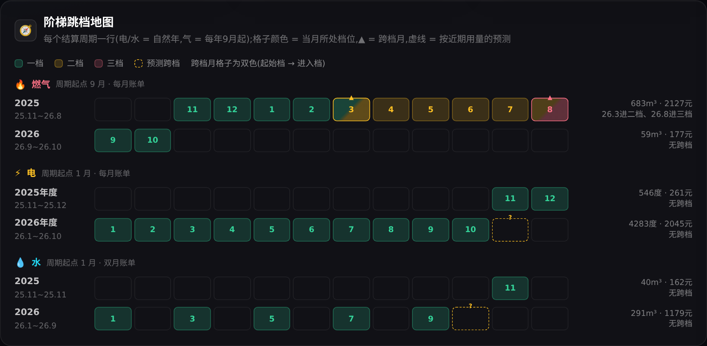
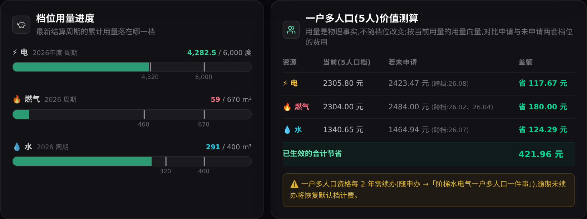
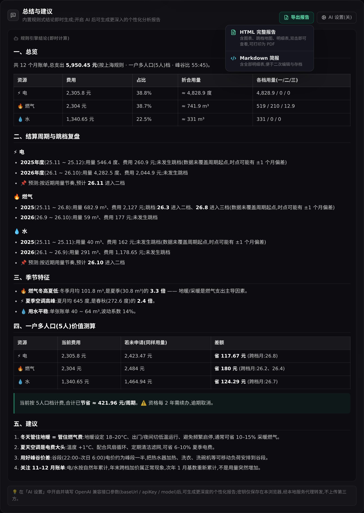
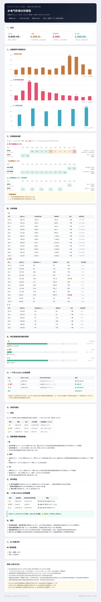

# Utility Bill Lens · 家庭水电气阶梯分析

输入每月缴费金额,自动完成:**用量反推 → 阶梯跳档定位 → 一户多人口价值测算 → 总结建议**,可选接入 AI 生成深度分析报告。

- 内置**上海规则**:电/水按自然年累计、燃气按每年 9 月–次年 8 月结算、峰谷分时电价、跨档临界月按未分时平均价、一户多人口(5人)额度增量
- 数据量不设限:12 / 24 / 36 个月及以上,引擎按结算周期自动分组逐周期分析
- 隐私友好:所有计算在浏览器本地完成,**无数据库**,配置仅存 localStorage
- 可扩展:规则全部数据化(档位/单价/周期/账单频率),高级设置中可改价格适配其他城市;新增城市只需在 `src/core/rules/` 增加一个 RuleSet

## 界面预览

**① 录入账单** —— 手动 / CSV·Excel 上传 / 粘贴文本,自动识别表头;只填金额,用量与跳档自动反推
<p align="center"></p>

**② 总览与趋势** —— 支出结构、三资源金额与反推用量,空调峰与地暖峰一目了然
<p align="center"></p>

**③ 阶梯跳档地图** —— 每个结算周期一行,格子颜色 = 当月档位,▲ = 跨档月,虚线 = 按近期用量预测
<p align="center"></p>

**④ 档位进度与一户多人口价值** —— 累计用量落在哪一档;申请与未申请的费用对比与节省金额
<p align="center"></p>

**⑤ 总结建议** —— 规则式结论即时生成,可选 AI 深度分析;右上「导出报告」支持 HTML / Markdown
<p align="center"></p>

**导出的 HTML 报告** —— 单文件自包含(图表、明细表、建议、口径附录),浏览器打开即可、可打印为 PDF
<p align="center"></p>

## 快速开始

```bash
npm install

# 方式一:生产模式(推荐)
npm run build
npm start            # http://localhost:8787(前端 + API 同端口)

# 方式二:开发模式(两个终端)
npm run dev:server   # API 服务 :8787
npm run dev          # 前端 :5173(/api 自动代理)
```

## 使用说明

1. **录入账单**(三选一):
   - 手动输入:逐月填缴费金额(空 = 无账单;水费双月账单只在缴费月填)
   - 上传 CSV / Excel:自动识别表头(宽表每月一行 / 长表每月多行均可),支持 UTF-8 与 GBK 编码;识别失败且开启 AI 时自动让 AI 识别列含义
   - 粘贴文本:直接从 Excel 复制粘贴
   - 日期格式支持 `2025.11 / 2025-11 / 2025/11 / 2025年11月 / Excel 日期` 等
2. **选择规则**:是否一户多人口(5人)档;峰电量占比滑杆(仅影响电量反推精度)
3. **查看分析**:KPI 总览、金额+用量趋势图、阶梯跳档地图(泳道)、档位进度条、一户多人口价值测算、规则式结论
4. **AI 深度分析(可选)**:右上角 AI 设置 → 开启并填 OpenAI 兼容参数(Base URL / API Key / 模型)→ 点「AI 深度分析」流式生成报告
5. **导出分析报告**:「导出报告」下拉 →
   - **HTML 完整报告**:单文件自包含(内嵌样式与 SVG 图表、跳档泳道地图、月度明细表、价值测算、建议、口径附录),双击即可查看,浏览器打印可直接存为 PDF;若已生成 AI 报告会一并写入
   - **Markdown 简报**:含全部明细表,便于二次编辑与存档

## 架构

```
src/core/            纯 TS 计算引擎(零依赖,前后端共用)
  types.ts           类型:规则、账单、分析结果
  rules/shanghai.ts  上海规则(城市注册表,可扩展)
  engine.ts          周期分组 / 金额→用量阶梯反推 / 用量→金额 / 5人口对比 / 跨档预测
  insights.ts        规则式总结建议(季节检测、跳档复盘、省钱建议)
  parse.ts           CSV/Excel 解析、表头智能映射、编码嗅探、AI 列映射兜底
src/components/      React UI(输入面板 / 仪表盘 / 泳道跳档图 / 价值测算 / AI 报告 / 导出)
server/index.ts      Hono 极薄后端:仅 AI 代理(隐藏 CORS,流式转发)+ 静态托管
src/lib/report.ts    报告导出:自包含 HTML(内嵌 SVG 图表与泳道,可打印为 PDF)+ Markdown 简报
scripts/             验证脚本(引擎 28 项 + 解析 22 项 + 报告 20 项断言;report-screenshot.ts 为开发用截图工具)
```

- **无数据库**:数据即时解析即时计算;刷新后账单需重导(可粘贴保存在本地文件),AI 配置与规则改动存 localStorage
- **AI 安全**:API Key 只存浏览器;请求经本地服务代理转发至你自己填写的接口,不经过任何第三方

## 验证

```bash
npx tsx scripts/verify.ts       # 引擎正确性(与真实账单手工核算对齐)
npx tsx scripts/verify-parse.ts # 解析正确性(真实 CSV / 长表 / 无表头 / 日期格式)
npm run typecheck
```

## 扩展指南

- **新增城市**:在 `src/core/rules/` 复制 shanghai.ts 修改档位/价格/周期,并在 `ruleSets` 注册——引擎与 UI 零改动
- **价格调整**:无需改代码,高级设置中直接编辑(存 localStorage)
- **AI 兼容**:任何 OpenAI `/chat/completions` 兼容服务(DeepSeek / OpenAI / Moonshot / Ollama / 中转)均可
- **更多资源类型**(如宽带):在 `ResourceType` 与 RuleSet 中扩展,引擎按资源泛化实现
